# EDAmbilight

**Real-time screen ambient lighting controller for OpenRGB**


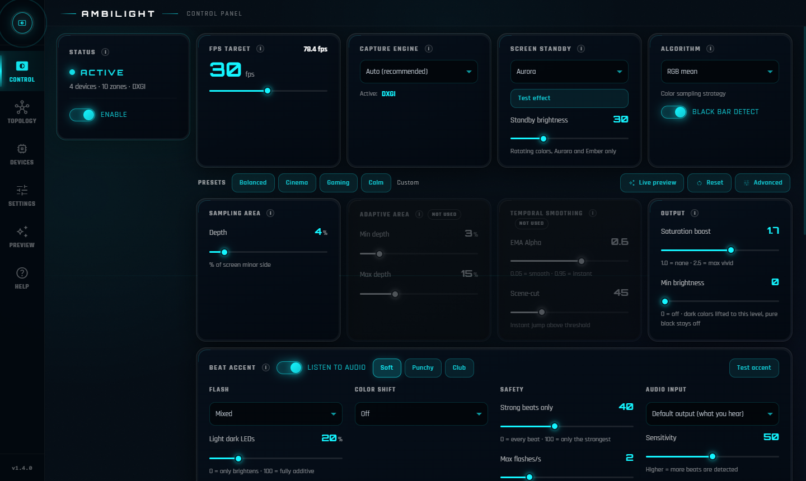

---

## 📥 Download

➡️ **[Latest Release](../../releases/latest)**

Download the `EDAmbilight-vX.Y.Z.zip` from the release page, extract anywhere, run `EDAmbilight.exe`.
No Python or extra dependencies needed.

> **OpenRGB must be running** with the SDK Server enabled before launching EDAmbilight.
> In OpenRGB: *Settings → SDK Server → Start Server* (default port 6742)

> **Windows SmartScreen warning:** the exe is not code-signed yet, so Windows may show
> *"Windows protected your PC"* / *"Unknown publisher"* on first launch. This is expected.
> Click **More info → Run anyway**. If the zip itself is blocked, right-click it →
> *Properties* → tick **Unblock** before extracting. To verify the download, compare
> `certutil -hashfile EDAmbilight-vX.Y.Z.zip SHA256` with the `.sha256` file on the release page.

---

## ✨ Features

- **Real-time screen capture** — samples all four monitor edges (right, top, left, bottom)
- **Smart sampling strategies** — adaptive depth, percentile, dominant color, mean, and smooth blending
- **Black bar detection** — automatically ignores letterbox / pillarbox borders
- **Scene-cut bypass** — instant color jump on hard cuts, smooth EMA transitions otherwise
- **Saturation boost** — vivid LED output without oversaturation
- **Sampling preview** — a scaled copy of your screen showing exactly where each LED reads its color, live or as plain zones; hover a band or a dot to see which device it feeds
- **Beat accent** — at every beat of the music playing on the PC the ambilight gets a short flash and/or hue shift: multiplicative, additive or mixed, with your own flash color, duration, intensity and a flash-rate safety limit (needs the optional `PyAudioWPatch` package)
- **Screen standby effects** — when the display sleeps or locks, the LEDs can hold, fade out, pulse, rotate colors, show an aurora or an ember glow
- **Light and dark theme** — a frosted-glass light theme next to the dark one, switched from the sidebar and remembered (also in `config/settings.json`); dropdown lists are translucent panels that blur what is behind them
- **WebGL live preview** — visualise the ambient effect in the browser before it hits the LEDs

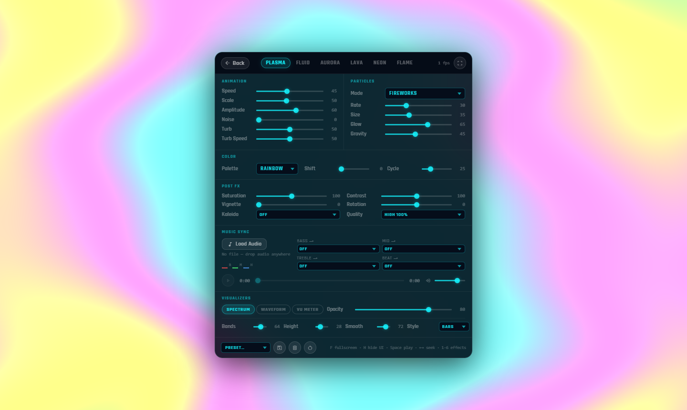

- **Visual topology editor** — drag-and-drop canvas to map LED zones to screen regions
- **System tray** — minimize to tray; reopen the UI from any browser tab
- **OpenRGB auto-start** — launches OpenRGB automatically if it is not already running
- **No internet required** — fully local, no telemetry, no cloud

---

## 🔧 Requirements

| | |
|---|---|
| OS | Windows 10 / 11 (64-bit) |
| [OpenRGB](https://openrgb.org) | v1.0 or later recommended, SDK Server enabled. Tested with 1.0rc2 and 1.1. Older servers (SDK protocol 0–4) are handled by the client but not tested on real hardware |
| [PawnIO](https://pawnio.eu) | Driver OpenRGB 1.x uses for memory and motherboards. Without it those devices are not detected |

---

## 🚀 Quick Start

1. Start **OpenRGB** → *Settings → SDK Server → Start Server*
2. Extract the release zip and run **EDAmbilight.exe**
3. The splash screen initialises and the dashboard opens automatically
4. Open **Topology**, press **Fit** on the *Screen* panel (or drag the SCREEN rectangle onto your monitor's strips) and save
5. In **Devices**, switch on the devices you want to drive and pick their zones, then toggle **Enable**
   on the Dashboard — LEDs follow your screen in real time. The *Getting started* checklist shows what is missing.

---

## 🖥️ The Interface

### Splash Screen

Shown on every launch. Displays live progress as EDAmbilight connects to OpenRGB, starts the sampling service, and registers the API.

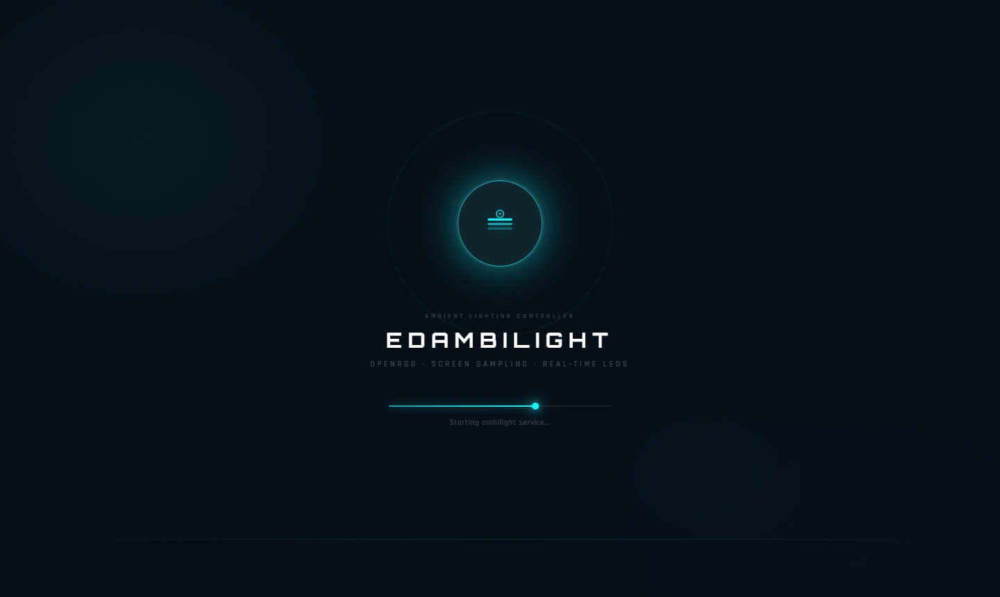

If OpenRGB is not reachable an error banner appears with a **Retry** button — start OpenRGB, enable the SDK Server, then click Retry without restarting the app.

* * *

### Dashboard — Control

The main page. All sampling parameters are adjustable in real time with instant effect on the LEDs.


| Control | Description |
|---|---|
| **Enable toggle** | Master on/off for ambilight output |
| **Capturer** | Screen capture backend (Auto / WGC / DXGI / mss) |
| **FPS Target** | Sampling rate in frames per second |
| **Strategy** | Color sampling algorithm (see Configuration) |
| **Depth min / max** | Adaptive sampling depth range as % of screen |
| **EMA Alpha** | Smoothing factor — higher = faster color response |
| **Scene-cut threshold** | Delta that triggers an instant cut instead of EMA |
| **Saturation boost** | Color intensity multiplier |
| **Min brightness** | Lifts dark colors to a minimum level |
| **Screen standby** | What the LEDs do while the screen gives no image: hold, slow fade, dim glow, pulse, rotating colors, aurora, ember or off |
| **Standby brightness** | Level of the rotating colors, aurora and ember effects |
| **Presets** | Balanced / Cinema / Gaming / Calm in one click; *Reset* restores the defaults |
| **Advanced** | Shows or hides the fine-tuning sliders |

The **Sampling** panel (above the device list) draws your screen with the same proportions and shows what the LEDs read: the edge bands at their real depth (the adaptive depth changes with the picture), detected black bars, and one dot for each device that is not on the monitor frame. **Live** shows the color each LED is receiving, **Zones** shows only the sampled areas. Hover a band or a dot to see the device and zone it feeds.

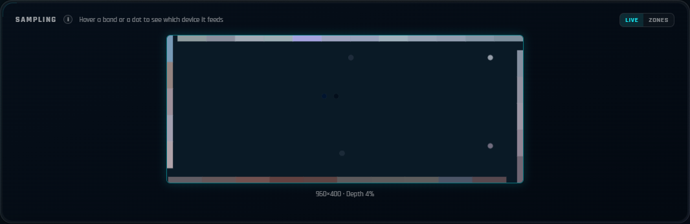

The **Beat accent** panel adds a short accent to the ambilight at every beat of the sound your PC is playing (system audio, no microphone needed). **Mode** chooses how the flash is applied: *Multiplicative* brightens the picture colors and keeps their hue (a black LED stays off), *Additive* adds the **flash color** you pick (dark LEDs light up too), *Mixed* does both, and **Light dark LEDs** sets how much is additive. **Intensity** and **Duration** set the size and the fade of the flash. **Color shift** rotates the hue at the beat: *Pulse* comes back at once, *Step* adds one notch per beat and fades back slowly. **Safety** keeps only the strongest beats (Strong beats only: 0 follows every beat, 100 only the biggest hits), limits the flash rate (Max flashes/s), the size of the jump (Boost cap) and how fast it rises (Attack); set Max flashes/s to *off* to experiment. **Test accent** fires one beat without any audio, and the Soft / Punchy / Club presets are starting points. Turn on **Listen to audio** to follow the music; the meter shows what is heard.

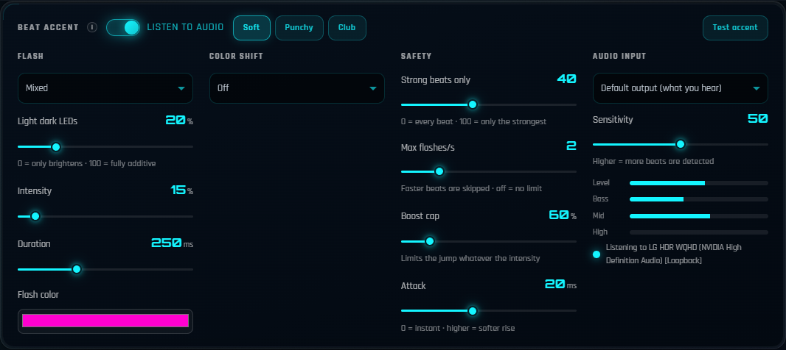

> The release already includes audio listening. When running from source it needs the optional `PyAudioWPatch` package (`pip install PyAudioWPatch`); without it the panel still works with **Test accent**, and the meter explains what is missing. If the audio source you picked is no longer there (headset unplugged), the app listens to the default output and says so in the panel.

The **Status** panel reports `ACTIVE`, `INACTIVE`, `STANDBY` (the screen gives no frames: display asleep or locked),
`NO ZONES` (running, but no zone receives colors) or `NO DEVICES` (OpenRGB reports nothing), with a hint on how to fix it.

> **Screen standby** starts when the capture stops delivering frames. With the DXGI engine (also
> chosen by *Auto*) this happens about 45 s after the display turns off, because the app first tries
> to recover the capture. Normal ambilight resumes by itself when the screen is back.

* * *

### Devices

The one place to manage your hardware. Each device is a row with its on/off switch; open it (**Zones**)
to enable or disable its individual zones. Only enabled zones receive color data. A small live
**Sampling** preview at the top shows at once what turning a device or zone on or off does.
Keyboards are listed like any other device and are off until you switch them on. A keyboard that
OpenRGB describes as a key grid (e.g. 24 × 6) becomes a tiny copy of the screen: every key shows the
mean color of the part of the screen it sits under. Other zones read one point of the screen.

The Dashboard keeps a compact row of on/off chips for the same devices, a summary
("2 of 6 devices on · 11 zones receiving colors") and a warning when nothing would light up.

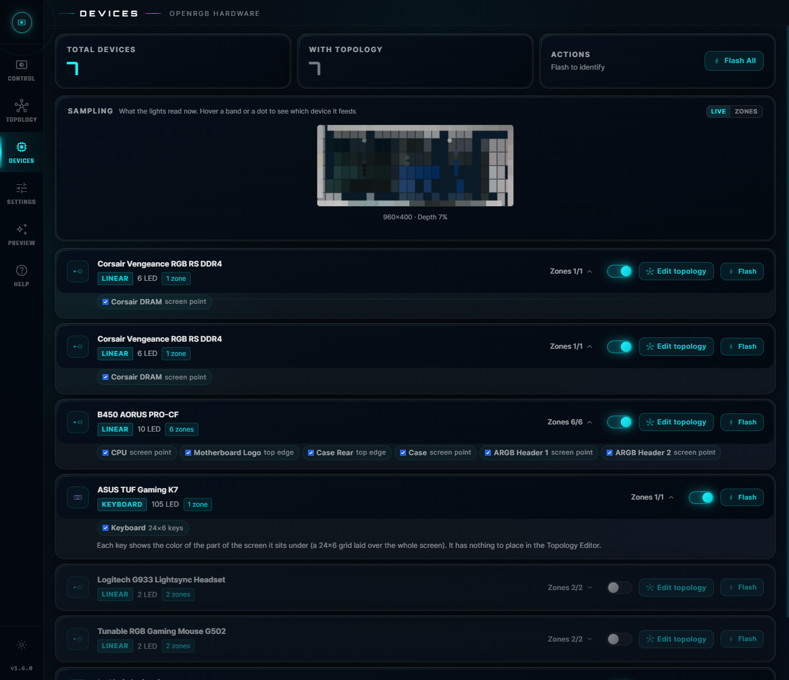

Click **Edit topology** (or **Map zones** for a device without topology) to open the topology editor.
**Flash** / **Flash All** blink the LEDs so you can identify each device.

* * *

### Topology Editor

Drag LED zones on the canvas and place the **SCREEN** rectangle where your monitor is (**Fit** does it
from the strips; drag a corner to resize, the border to move). The rectangle always keeps the
proportions of your real screen, so draw the strips to scale around it. Where a LED sits decides what it shows,
whatever the zone is called: on a side of the rectangle it follows that side of the screen, inside it
reads the point of the screen under it (the centre of the rectangle reads the centre of the screen),
outside it stays off. Faded LEDs on the canvas are outside; a dot on a LED means it reads one point.
Older setups that name their zones MonitorTop / MonitorRight / MonitorBottom / MonitorLeft keep
the old name-based mapping until the rectangle is placed. Changes take effect without restarting.

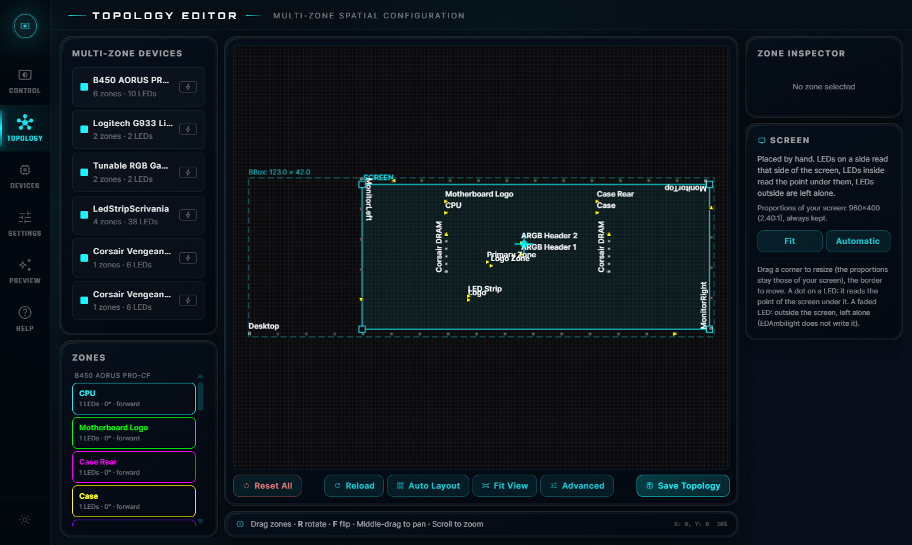

* * *

### Settings

Configure the OpenRGB connection (host, port, executable path, auto-start) and the web UI port,
restart or quit the app, and open the log folder.

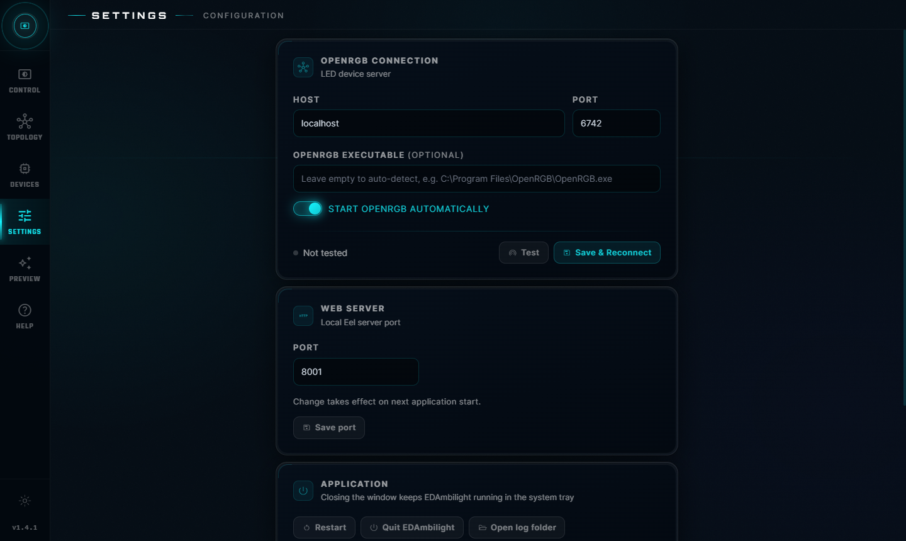

* * *

### Light theme

Every page also comes in a light "glass" theme. Use the sun / moon button at the bottom of the
sidebar (in the panel header on Live Preview); the choice is remembered, and the splash screen
follows it.

| | |
|---|---|
| 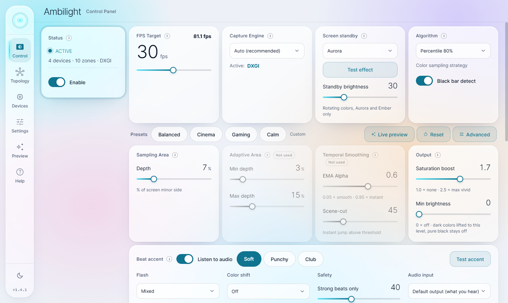 | 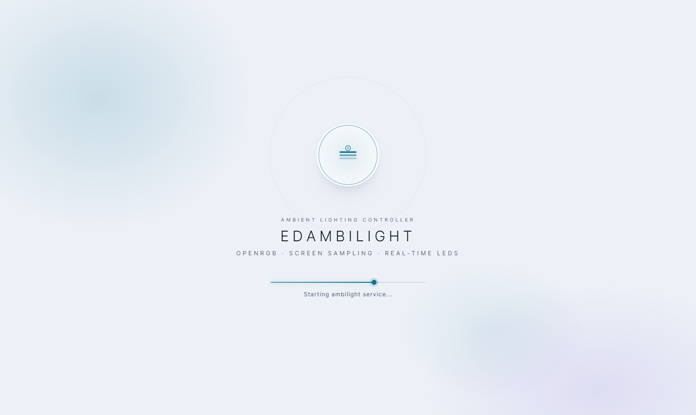 |
| 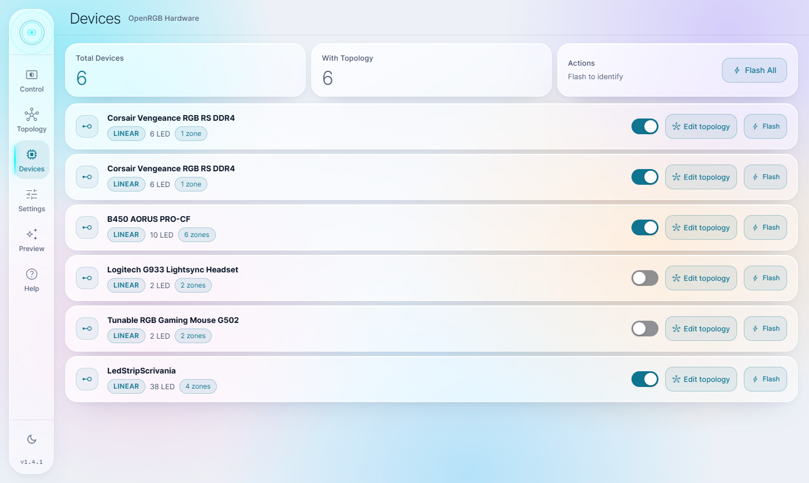 | 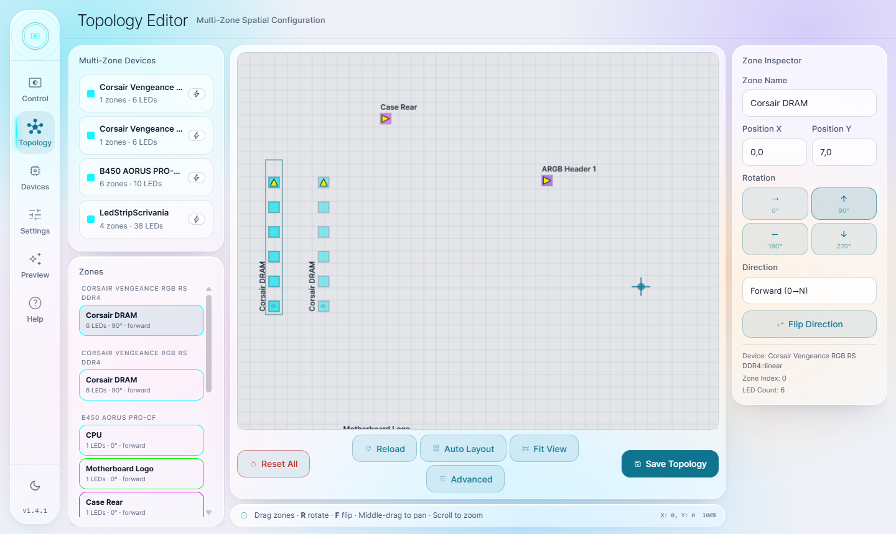 |
| 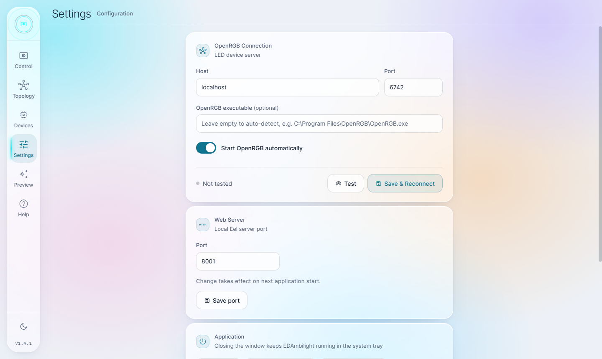 | 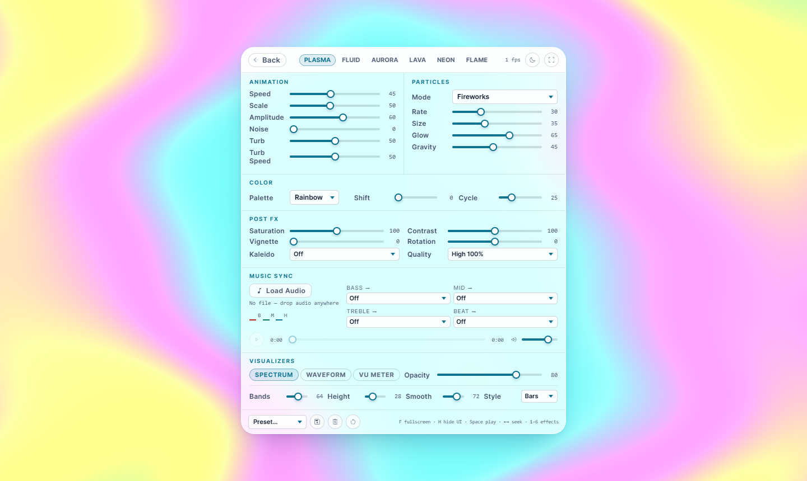 |

---

## ⚙️ Configuration

Configuration files are stored in the `config/` folder next to the exe and are created automatically on first run.

### `config/settings.json`

```json
{
  "openrgb_host": "localhost",
  "openrgb_port": 6742,
  "openrgb_path": "",
  "openrgb_autostart": true,
  "web_port": 8001
}
```

| Key | Default | Description |
|---|---|---|
| `openrgb_host` | `"localhost"` | OpenRGB SDK server hostname or IP |
| `openrgb_port` | `6742` | OpenRGB SDK server port |
| `openrgb_path` | `""` | Absolute path to `openrgb.exe` (empty = autodetect) |
| `openrgb_autostart` | `true` | Launch OpenRGB automatically if not running |
| `web_port` | `8001` | Port for the built-in web UI |

### `config/ambilight_config.json`

| Key | Default | Description |
|---|---|---|
| `enabled` | `true` | Master on/off |
| `capturer` | `"auto"` | `auto` \| `wgc` \| `dxgi` \| `mss` |
| `fps` | `10` | Target frames per second |
| `strategy` | `"adaptive_smooth"` | Sampling strategy (see below) |
| `depth` | `10` | Base sampling depth as % of screen |
| `saturation_boost` | `1.6` | Saturation multiplier |
| `min_luminance` | `0` | Brightness floor (0–255): colors darker than this are lifted to it, hue kept; pure black stays off. 0 = disabled |
| `ema_alpha` | `0.5` | EMA smoothing factor (0 = frozen, 1 = instant) |
| `scene_cut` | `43` | Per-LED delta that bypasses EMA |
| `adaptive_min` | `3` | Minimum adaptive depth % |
| `adaptive_max` | `18` | Maximum adaptive depth % |
| `black_bar_detect` | `true` | Skip letterbox / pillarbox borders |

**Sampling strategies**

| Strategy | Description |
|---|---|
| `adaptive_smooth` | Adaptive depth + EMA — recommended for most content |
| `smooth` | Fixed depth + EMA |
| `percentile` | 80th-percentile luminance — vibrant colors |
| `dominant` | Median pixel — stable, natural colors |
| `mean` | Average all pixels — accurate but can look washed out |

---

## 📊 How It Works

```
┌─────────────────────────────────────────────────────────────────┐
│  Screen Capture  (WGC → DXGI → mss, auto-selected)              │
│         ↓                                                       │
│  Black Bar Detection  →  content rect [x0,y0,x1,y1]             │
│         ↓                                                       │
│  Per-Edge Strip Extraction  (adaptive or fixed depth)           │
│         ↓                                                       │
│  Per-LED Segment Sampling  (percentile / dominant / mean)       │
│         ↓                                                       │
│  Saturation Boost                                               │
│         ↓                                                       │
│  Temporal Smoothing (EMA)  ←→  Scene-Cut Bypass                 │
│         ↓                                                       │
│  OpenRGB SDK  →  LED Strip / Mouse / Headset / RAM / Motherboard│
└─────────────────────────────────────────────────────────────────┘
```

The sampling loop runs as a background thread at the configured FPS. Each frame is captured once and shared across all active devices — the strip extraction cache means each screen edge is processed only once per frame regardless of how many devices or zones reference it.

---

## 🔍 Troubleshooting

**"Windows protected your PC" / "Unknown publisher"**
The exe is not code-signed. Click *More info → Run anyway*, or unblock the zip
(right-click → Properties → Unblock) before extracting.

**"OpenRGB not found" on the splash screen**
Make sure OpenRGB is running with the SDK Server enabled on port 6742.
If OpenRGB is in a non-standard location, set `openrgb_path` in `config/settings.json`.

**LEDs do not respond**
- Check that the device and zone are enabled in the Devices page
- Verify OpenRGB can control the device directly (use the OpenRGB UI)

**UI does not open automatically**
Navigate manually to `http://localhost:8001` (or your configured `web_port`).

**High CPU usage**
Lower `fps` in `ambilight_config.json` (e.g. `5`).
Switch `capturer` from `mss` to `wgc` or `dxgi` for lower CPU overhead.

**Colors look washed out**
Increase `saturation_boost` (try `1.8`–`2.2`).

**Colors flicker or stutter**
Lower `ema_alpha` (e.g. `0.3`) for smoother transitions, or raise `scene_cut` to make instant cuts less sensitive.

**Black bars are not detected**
Enable `black_bar_detect` in `ambilight_config.json`. Works best with static 16:9 or 21:9 content; may not activate during very dark scenes (expected — the algorithm needs visible content to locate the border).

**LEDs turn off when playing protected content (Netflix fullscreen, etc.)**
This is due to **HDCP (High-bandwidth Digital Content Protection)** — a DRM protection used by streaming services. When HDCP is active:
- Windows screen capture APIs (WGC, DXGI, etc.) return completely black frames
- All LED zones appear black with no color information

**This is a Windows/hardware limitation, not a bug.** HDCP content cannot be screen-captured on Windows.

*Workarounds:*
- Watch in **windowed mode** instead of fullscreen
- Check your GPU driver settings for an option to disable HDCP (may reduce streaming quality to 1080p)
- Use a different display output if available (some HDMI ports bypass HDCP if not connected to protected displays)

---

## 📁 Directory Structure

```
EDAmbilight/
├── EDAmbilight.exe         ← run this
├── _internal/              ← Python runtime (do not modify)
├── web/                    ← UI assets (HTML, CSS, JS, fonts)
├── config/                 ← created on first run
│   ├── settings.json       ← OpenRGB / web port settings
│   ├── ambilight_config.json  ← sampling parameters
│   └── device_topologies.json ← LED zone layout
└── log/                    ← created on first run
```

---

## 🛠 Source code

The code in this repository is what the releases are built from. To run it from
source or build the exe yourself, see [README-dev.md](README-dev.md).

Bug reports and ideas are welcome as [issues](../../issues). Pull requests are
not accepted.

---

## 📄 License

The source code is public, but EDAmbilight is **source-available, not open source**.
It is licensed under the [PolyForm Noncommercial License 1.0.0](LICENSE): you can
read, run, modify and share it for any noncommercial purpose; commercial use is
not allowed.

- [NOTICE.md](NOTICE.md) — the name and logo, official builds, contributions
- [THIRD-PARTY.md](THIRD-PARTY.md) — licenses of the fonts, icons and libraries used

Releases up to 1.3.1 were distributed under a separate freeware license, which
still governs those downloads.
